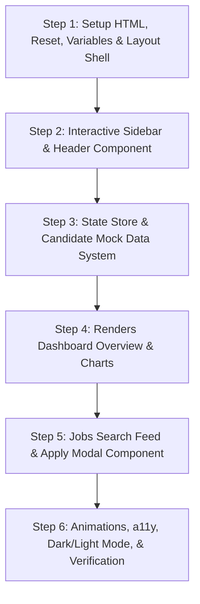

# Job Portal Dashboard - Project Architecture & Roadmap

This document outlines the architecture, technical stack, folder structure, design system, and step-by-step development roadmap for building a startup-grade Job Portal Dashboard using semantic HTML, vanilla CSS, and modern Vanilla JS (ES6 modules).

---

## Technical Stack & Choices

To achieve a production-level, high-performing codebase, we will use:
1. **HTML5**: Semantic tags (`<header>`, `<nav>`, `<main>`, `<aside>`, `<section>`, `<article>`) for SEO and Accessibility (a11y).
2. **Vanilla CSS**: CSS Custom Properties (variables) for standardizing design tokens (colors, fonts, gaps, animations), Flexbox and Grid layouts, CSS Grid-based masonry/charts, and CSS animations. No Tailwind or third-party CSS libraries.
3. **Vanilla JS (ES6 Modules)**: Modular code division. Each component or page-view is a class or functional module. We'll use a single-page approach driven by modular routing and client-side state management (a custom lightweight Store pattern).
4. **SVG Icons**: Vector-based, inline or dynamic icons to maintain crisp rendering, theme color inheritance, and page performance.

---

## Design System & Theme

To stand out as a premium startup dashboard, the UI will employ **Modern Glassmorphic Dark/Light Mode Adaptability** (prioritizing a rich, dark-mode default for developers/recruiters).

### Color Palette (HSL based)
- **Primary / Accent**: Deep Indigo / Violet (`hsl(250, 84%, 60%)`)
- **Success / Positive**: Emerald Green (`hsl(142, 70%, 45%)`)
- **Warning / Pending**: Amber Gold (`hsl(38, 92%, 50%)`)
- **Background (Dark)**: Deep Cosmic Obsidian (`hsl(222, 47%, 11%)` to `hsl(222, 47%, 7%)`)
- **Card Background (Dark)**: Semi-transparent Glass (`hsla(222, 47%, 15%, 0.6)`)
- **Text (Dark)**: Muted Lavender White (`hsl(210, 40%, 98%)`) and Secondary Text (`hsl(215, 20%, 65%)`)
- **Borders**: Translucent Glass borders (`hsla(222, 47%, 25%, 0.4)`)

### Typography
- We'll load the **Outfit** or **Plus Jakarta Sans** Google Fonts for a clean, tech-focused, and premium visual hierarchy.
- Smooth transitions on interactive state changes (0.3s cubic-bezier).

---

## Folder Structure

Here is the proposed production-ready file architecture:

```text
Job-Portal/
├── index.html                  # Main entry point & SEO metadata
├── favicon.ico                 # Site favicon
├── css/
│   ├── variables.css           # CSS custom properties (design system tokens)
│   ├── reset.css               # Modern CSS reset (box-sizing, margins, image-fluid, etc.)
│   ├── global.css              # Global styles (layout shell, body text, utility classes)
│   ├── components/
│   │   ├── sidebar.css         # Collapsible sidebar styles (Mobile first)
│   │   ├── header.css          # Search, notifications, and profile header
│   │   ├── cards.css           # Stat widgets and Job lists styles
│   │   ├── modal.css           # Glassmorphic modal popups
│   │   └── charts.css          # Custom CSS-based dashboard analytics chart
│   └── pages/
│       ├── dashboard.css       # Page styling specifically for the Dashboard view
│       └── jobs.css            # Page styling for Job listing search
├── js/
│   ├── app.js                  # App bootstrap, simple router, and light/dark theme toggle
│   ├── store.js                # Global state store (Reactive observer pattern for mock database)
│   ├── components/
│   │   ├── Sidebar.js          # Sidebar JS class
│   │   ├── Header.js           # Header JS component
│   │   ├── JobCard.js          # Reusable Job card generator
│   │   ├── Modal.js            # Dynamic component details modal drawer
│   │   └── AnalyticsChart.js   # Dynamic CSS SVG chart rendering
│   ├── pages/
│   │   ├── DashboardView.js    # Renders overview metrics, activity, and applications
│   │   └── JobsView.js         # Renders search filters, job feed, and apply handlers
│   └── utils/
│       ├── helpers.js          # Common string, formatters, and animation utilities
│       └── mockData.js         # Startup-grade mock datasets (Jobs, Applicants, Trends)
└── assets/
    ├── icons/                  # Raw SVG icons (if loaded dynamically)
    └── images/                 # Mock avatars, company logo assets
```

---

## Open Questions & User Choices

Before starting the code structure, I want to clarify:
1. **Dashboard Purpose**: Should the dashboard cater to **Candidates** (tracking their applications, searching jobs, resume analytics) or to **Employers** (listing job openings, reviewing applicants, hiring metrics)?
   * *Recommendation*: A **Candidate Dashboard** is excellent for portfolio demonstration since it showcases highly interactive components like job searching, applying, dynamic status flows, and statistics.
2. **Icons**: Do you prefer we use custom raw SVG components embedded inline (best for customization and loading speeds) or a light-weight CDN icon pack like Lucide-icons?
   * *Recommendation*: Custom raw SVGs embedded in the JS/HTML files to prevent external CDN delays and maintain self-contained high performance.

---

## Step-by-Step Roadmap

Our step-by-step incremental approach will proceed as follows:



### Step 1: Base CSS Tokens & Entry HTML Shell
We will set up `index.html`, `css/variables.css`, `css/reset.css`, `css/global.css`, and create the main dashboard grid structure.

### Step 2: Sidebar, Header & Theme Toggles
Build the layout drawer. Add full keyboard accessibility and mobile responsiveness (collapsing sidebar with transition effects).

### Step 3: Mock Data Store
Implement the `js/store.js` database model which stores current jobs, candidate applications, user profile, and simple search queries.

### Step 4: Overview Dashboard View
Implement the main view containing dynamic key metric cards, dynamic graph analytics (using beautiful SVG grids and glassmorphic charts), and recent application listings.

### Step 5: Jobs Listing View, Advanced Filters, and Detail Modal
Build a search view with search text, location selection, and type (Full-time, Remote, etc.). Clicking a job card triggers an overlay modal explaining detail summaries and applying triggers.

### Step 6: Polish, Transition Animations, Performance Audit, and Verification
Refine all transitions, add scroll triggers, ensure aria-labels are compliant, perform CSS/JS optimization checks, and prepare the project walkthrough.

---

## Verification Plan

### Manual Verification
- View layout responsiveness on standard screen widths: Mobile (375px), Tablet (768px), Laptop (1024px), Desktop (1440px).
- Verify interactive component states (Hover, Focus, Active).
- Perform Keyboard Tab navigation to verify accessible focus loops.
- Verify state updates (e.g. applying for a job correctly increments application counters and populates in the active dashboard view).
